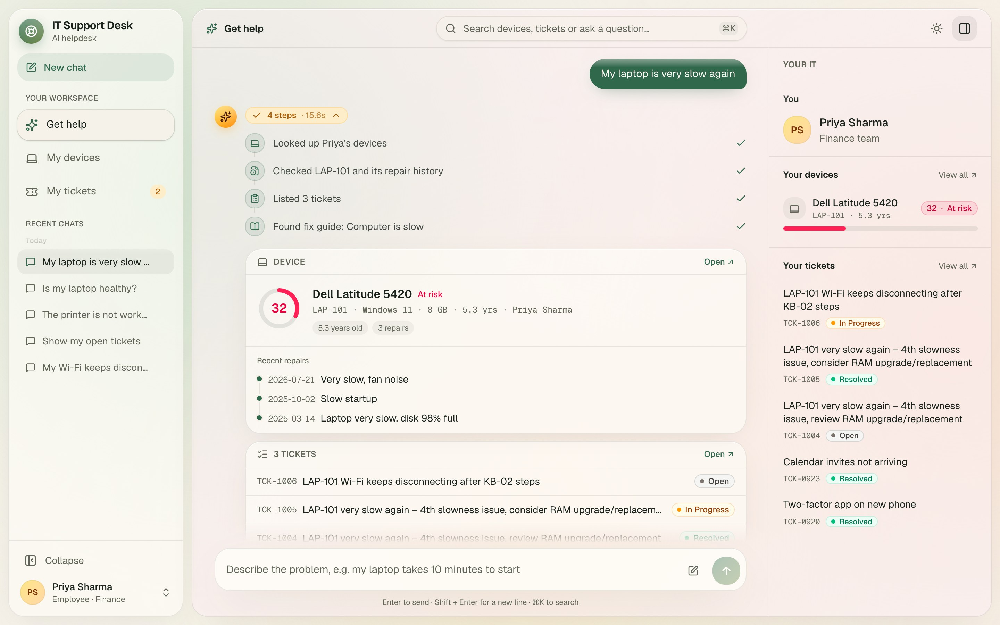
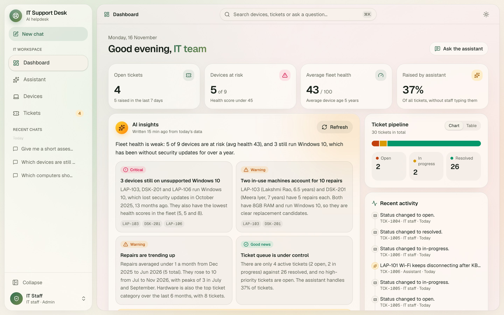
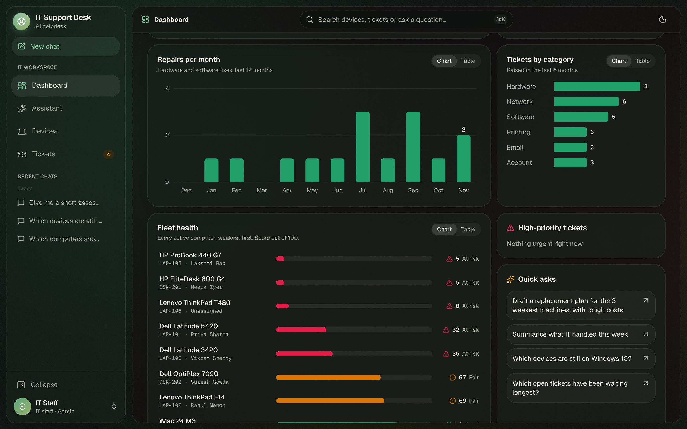
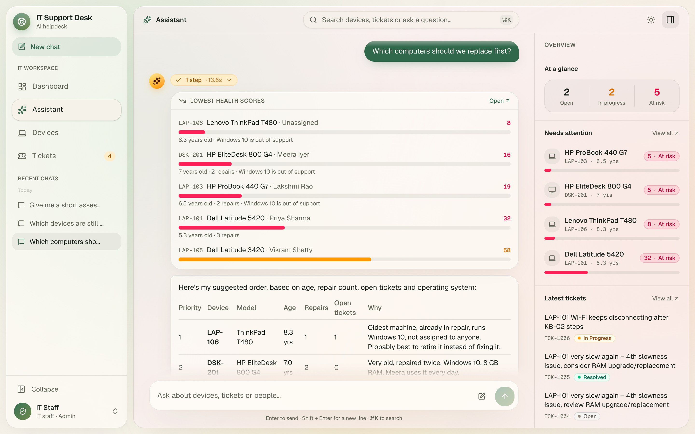
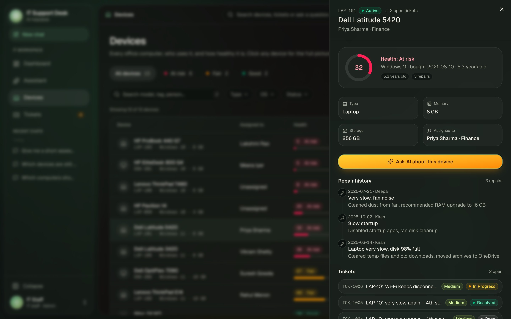
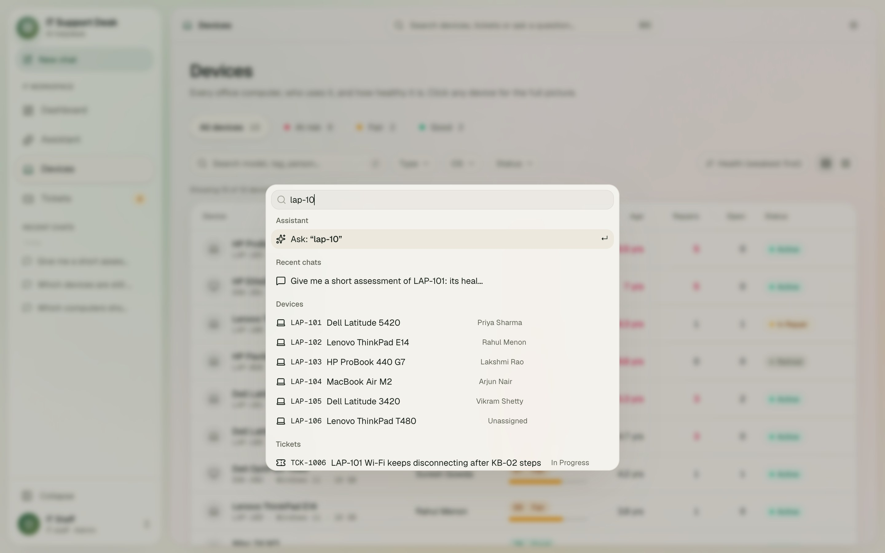
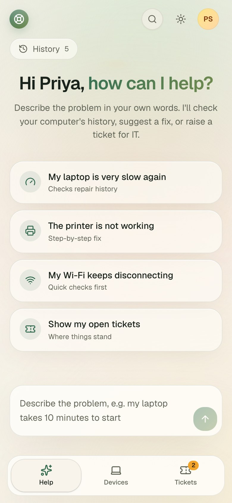
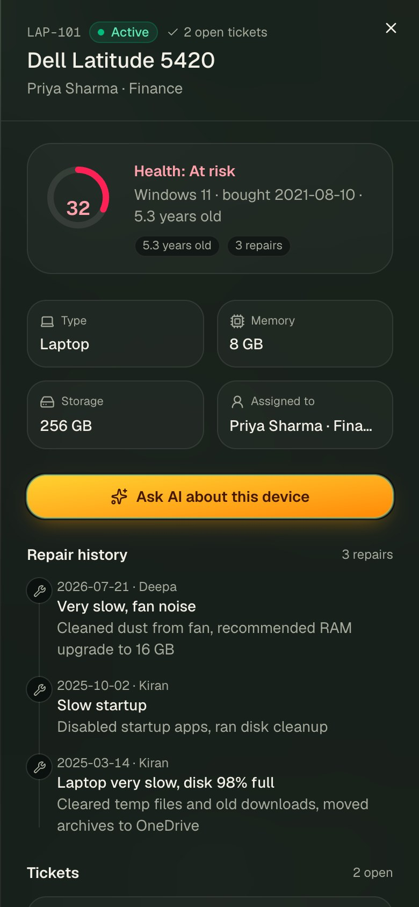

<div align="center">

# IT Support Desk

**An AI helpdesk agent for small offices.**
Describe a computer problem in plain words. The agent checks the machine's history, suggests a fix, and raises a ticket on its own when the problem keeps coming back.


*Personal portfolio project · runs on sample data for a made-up 50-person office*



</div>

---

## Why I built it

Small offices (20–100 people) rarely pay for a full IT service-management tool, but they still need to:

- keep track of every computer and its repair history,
- help **non-technical staff of any age** fix common problems themselves,
- and raise a proper ticket when something needs a technician.

I wanted to show how an **AI agent** can do that job end to end, and how to make an AI product **feel trustworthy**: you see what it's doing, why, and what it changed.

## Highlights

### 🤖 AI agent
- **Real tool-using agent** on the Claude API. It decides which of **8 tools** to call (look up devices, read repair history, search fix guides, raise or update tickets, analyse the fleet), runs them, and keeps going until it can answer.
- **Spots patterns, not just keywords.** "My laptop is slow *again*" → it sees 3 earlier repairs, an 8 GB machine over 5 years old, and an open ticket already covering it, so it **doesn't raise a duplicate**.
- **Streams live.** The answer appears word by word, and a **timeline shows each tool call** as it starts (spinner), finishes (✓) or is blocked (✗). The first step appears in about 2 seconds.
- **Generative UI.** Tools return structured data that the chat renders as **cards**: a device card with an animated health ring and repair timeline, a "ticket raised" card, a fleet health chart, and a "Try this first" checklist you can tick off.
- **Structured AI insights.** On the dashboard, Claude reads the live numbers and returns a typed report (Zod schema): a headline, findings with severity, linked device and ticket IDs, and one recommended next step.
- **Stop, Retry, follow-ups, history.** Stop a reply mid-way, retry after a network error, tap suggested follow-ups, and come back to **saved chats per profile**, which only that profile can open.

### 🎨 UI and UX
- **Framed glass workspace.** A collapsible rail plus one main surface (header, page and a collapsible inspector column) over a slowly drifting aurora background. Light and dark themes come from the same OKLCH design tokens.
- **Forest green on warm sand**, with **amber reserved for the AI**, so warm always means "the assistant did this".
- **⌘K command palette.** Jump to any device, ticket or chat, switch user, change theme, or type a question and press Enter to ask the assistant.
- **Accessible charts, hand-built in SVG** (no chart library). The colours were **checked with a palette validator** for colour-blind separation and contrast in both themes, and every chart has a **Chart / Table** toggle and hover tooltips.
- **Devices workspace** with search (`/`), filters, sorting, table/card views, **filters stored in the URL**, and a slide-in device panel with "✨ Ask AI about this device".
- **Motion with restraint.** A sliding active highlight, spring-in messages, staggered lists and page transitions, all off for people who prefer reduced motion.
- **Works on phones.** A floating dock, full-screen panels, and large readable text, because the promise is "usable by anyone in the office".

## Screenshots

| IT dashboard with AI insights | Dashboard charts (dark) |
|---|---|
|  |  |

| Fleet answer with a chart card | Device panel with "Ask AI" (dark) |
|---|---|
|  |  |

| ⌘K command palette | On a phone |
|---|---|
|  |   |

## How the agent works

```
 "My laptop is very slow again"
            │
            ▼
┌───────────────────────────────┐   tool_use    ┌──────────────────────────────┐
│ Claude + the tools this user  │ ────────────▶ │ My code runs the tool        │
│ is allowed to use             │ ◀──────────── │ (permission checks, Zod)     │
└───────────────────────────────┘  tool_result  └──────────────────────────────┘
            │  repeats until it has enough to answer (max 8 rounds)
            ▼
 Streamed to the browser as events: tool started → tool finished (+ card data) → text
```

| Tool | What it does | Employee | IT staff |
|---|---|:-:|:-:|
| `get_my_devices` | Who am I, which computers are mine | ✅ | |
| `find_employee` | Search people | | ✅ |
| `get_device_details` | Specs, health score, repair history, tickets | own only | ✅ |
| `search_known_fixes` | Step-by-step self-help guides | ✅ | ✅ |
| `create_ticket` | Raise a ticket | for themselves | ✅ |
| `list_tickets` | Ticket status | own only | ✅ |
| `update_ticket` | Change status, add a note | | ✅ |
| `get_fleet_report` | Which machines to replace | | ✅ |

Key files: [`src/lib/agent.ts`](src/lib/agent.ts) (streaming agent loop) · [`src/lib/tools.ts`](src/lib/tools.ts) (tools and permissions) · [`src/lib/insights.ts`](src/lib/insights.ts) (structured AI report) · [`src/app/api/chat/route.ts`](src/app/api/chat/route.ts) (streaming API and saved history).

## Security decisions

- **Permissions are enforced in code, not in the prompt.** Employees are never offered staff-only tools, and every tool checks again before it runs. Even if someone talks the model into it, opening another person's computer returns *"This device is not assigned to you."*
- **Model output is treated as untrusted input.** Every tool call is validated with Zod, on top of `strict: true` tool schemas.
- **Who is asking comes from the server session** (an httpOnly cookie), never from the request body. Pages, server actions and APIs all check it, so the insights API returns 403 to employees.
- **Conversations are stored on the server**, so the browser can't rewrite what the model or the tools said. A stopped or failed turn is never saved half-finished.
- **Questions passed between screens travel in session storage**, not the URL, so they never end up in browser history or server logs.

## Tech stack

**Frontend:** Next.js 16 (App Router, Server Components, Server Actions) · React 19 · TypeScript · Tailwind CSS 4 · shadcn/ui on Radix · Motion · cmdk · Sonner · Lucide
**AI:** Anthropic TypeScript SDK: tool use, streaming, structured outputs (Zod), refusal fallbacks
**Data:** JSON-file store with a write queue (easy to swap for PostgreSQL); demo data with six months of history

```
src/
├─ app/                 pages: assistant, dashboard, devices, tickets + API routes
├─ components/
│  ├─ chat/             live agent timeline, generative cards, follow-ups
│  ├─ dashboard/        stat tiles, SVG charts, AI insights, quick asks
│  ├─ devices/          filters, table/cards, slide-in device panel
│  └─ shell/            rail, header, ⌘K palette, mobile dock, theme
└─ lib/                 agent, tools, insights, metrics, health score, session
```

## Run it locally

```bash
pnpm install
cp .env.example .env.local   # then paste your Claude API key into .env.local
pnpm dev                     # http://localhost:3000
```

You need a Claude API key from [platform.claude.com](https://platform.claude.com). A few dollars of credit is plenty for a demo.

### Try this
1. As **Priya Sharma**, click **"My laptop is very slow again"**. Watch the live steps, the health ring, and the agent noticing her repeat repairs.
2. Ask *"Show me the repair history of DSK-201"*. It isn't her computer, so access is refused.
3. Switch to **IT Staff** (bottom of the sidebar), open the **Dashboard** and click **Generate insights**.
4. Go to **Devices**, filter **At risk**, open a device and click **Ask AI about this device**.
5. Press **⌘K** anywhere and type a question.

Use **Reset demo data** at the bottom of the Tickets page (as IT staff) to start again.

| Setting | Default | Meaning |
|---|---|---|
| `ANTHROPIC_API_KEY` | none | Required |
| `CLAUDE_MODEL` | `claude-opus-5-5` | `claude-haiku-5-5` is much cheaper for simple helpdesk chat |
| `CLAUDE_EFFORT` | `low` | `low`, `medium` or `high`: more careful reasoning, but slower |

## Roadmap

- [x] Tool-using agent with role-based permissions
- [x] Streaming replies, live tool timeline, generative UI cards
- [x] Saved chat history per profile
- [x] IT dashboard with structured AI insights and accessible charts
- [x] Devices workspace with URL filters and a slide-in panel
- [ ] Tickets board (drag between Open → In progress → Resolved)
- [ ] "How it works" case-study page
- [ ] PostgreSQL and real sign-in
- [ ] Email or Slack alerts for urgent tickets

## About

Built by **Arun P M**, frontend engineer focused on AI-powered products, design systems and interactive UI.

[LinkedIn](https://www.linkedin.com/in/arun-p-m-3a9005225/) · [GitHub](https://github.com/arunpm007)
